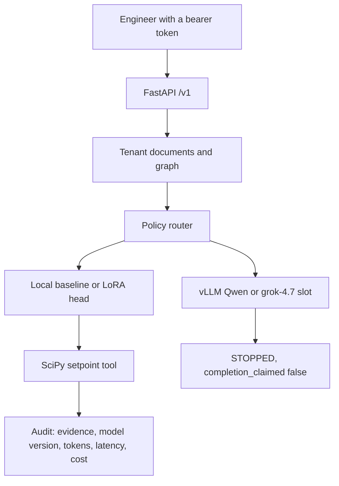
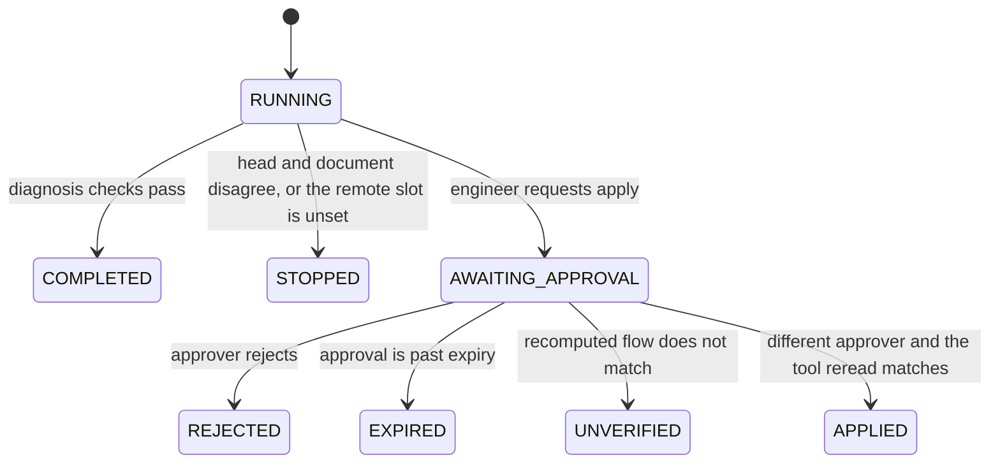

# IntelliForge AI — Model-Agnostic Intelligence & Evaluation Platform

An open-source reference platform for evaluating, adapting, routing, and governing model calls on synthetic engineering workloads.

Model-agnostic AI platform for open-weight LLM serving, LoRA adaptation, model routing, reproducible evaluations, knowledge retrieval, governed agents, and inference cost optimization.

This is a reference implementation. The equipment records are synthetic (`SYN-` identifiers, `real_equipment: 0`). It does not record production manufacturing experience.

The default path is a CPU mock: a FastAPI gateway, tenant retrieval, a NumPy LoRA head, a SciPy tool, and an approval gate. Qwen 2.5 3B on vLLM is the open-weight slot. It was not started. No GPU is required to run the tests.

**Deployment decision: NO-GO.** See [benchmarks/results/benchmark_report.md](benchmarks/results/benchmark_report.md) and [docs/benchmark-methodology.md](docs/benchmark-methodology.md).

| | |
| --- | --- |
| Package | `intelliforge-ai-platform` 0.1.0 |
| Gateway | FastAPI, tenant taken from the bearer token |
| Local head | NumPy LoRA, rank 2, seed 7 |
| Open-weight slot | `Qwen/Qwen2.5-3B-Instruct` through `POST /v1/chat/completions`. The weight load is refused on this machine |
| Commercial slot | `grok-4.7` at `https://api.x.ai/v1/chat/completions`. Unset `XAI_API_KEY` stops the run |
| Knowledge | In-process documents and graph. Neo4j and pgvector are compose profiles |
| Tool | SciPy bounded scalar optimization |
| Governance | Reader, engineer, approver. Apply waits for a different approver |
| Decision | NO-GO until a GPU serving run and a hosted call are measured |

## Architecture

An engineer asks why synthetic process `SYN-PROC-ETCH-01` is hot. The gateway copies the tenant from the token, retrieves that tenant's note, walks the equipment graph, and routes the case. The quality policy uses the LoRA head. The cost policy uses the zero head. Either remote policy stops before an HTTP call when its setting is absent. A diagnosis cites evidence and a recommended coolant flow, and it states that the setpoint was not applied.



Applying a setpoint is a separate action.



| Layer | What the demo runs | Adapter slot |
| --- | --- | --- |
| Gateway | FastAPI and Pydantic bodies that forbid extra fields | — |
| Routing | Quality and cost policies on the local heads | vLLM and xAI, fail closed |
| Adaptation | NumPy LoRA trained in this repository | Hugging Face PEFT, not imported |
| Evaluation | Qualification cases and a local JSON tracking record | MLflow client, not executed |
| Knowledge | Overlap retrieval and a three-hop graph walk | Neo4j and pgvector |
| Quantization | Int8 round-trip error on the local matrices | bitsandbytes |
| Science tool | SciPy `minimize_scalar` | A plant simulator |
| Governance | RBAC, audit rows, approval reread | An external identity provider |

The longer write-up is [docs/architecture.md](docs/architecture.md). Threats and the benchmark method are in [docs/](docs/).

## How this sits with the other references

| | [H100 GPU factory](https://github.com/JatinF/h100-ai-factory-reference-architecture) | [Healthcare AI factory](https://github.com/JatinF/healthcare-ai-factory-platform) | [IdentityGuard](https://github.com/JatinF/identityguard-agent-platform) | [OrchestraScale](https://github.com/JatinF/orchestrascale-airflow-platform) | This repository |
| --- | --- | --- | --- | --- | --- |
| Focus | GPU infrastructure acceptance | Imaging and private clinical inference | Identity-aware agent control | Airflow scheduling | Model routing, local adaptation, and governed tools |
| Outcome | Design and gates for the cluster | Synthetic imaging service path | Synthetic investigation with a durable pause | Measured workstation batch of 5,000 scheduled runs | Measured local head, retrieval, and tool path |

Each repository stands on its own evidence. A green local head here does not measure a GPU, a clinical model, or a cluster scheduler.

## Evidence

| Tag | Meaning in this repo |
| --- | --- |
| `EXAMPLE` | Synthetic cases, documents, and the sensor encoder |
| `ASSUMPTION` | 0.00015 USD per 1,000 whitespace tokens, dated 2026-10-21 |
| `DERIVED` | That price times measured whitespace tokens |
| `SPEC` | grok-4.7 list price from the vendor page on 2026-10-21. Zero calls |
| `GATE` | Deployment `NO-GO`. vLLM, PEFT, bitsandbytes, GPU memory, Neo4j, pgvector, MLflow, and the hosted call are `not-run` |
| `MEASURED` | Rows in [benchmarks/results/benchmark_report.md](benchmarks/results/benchmark_report.md) |

## This workstation run

The figures below are copied from that report. Machine line: Windows 11 AMD64, `processor=Intel64 Family 6 Model 140 Stepping 1, GenuineIntel`, `cpu_count=8`, Python 3.12.10.

| Measurement | Value |
| --- | --- |
| LoRA held-out accuracy | 1.0 |
| Baseline held-out accuracy | 0.333333 |
| Qualification cases | 4 |
| LoRA-route task completion | 1.0 |
| Baseline-route task completion | 0.25 |
| Local diagnose P95, 100 calls | 2.667 ms |
| Whitespace tokens per second | 73436.525774 |
| Int8 max absolute error | 0.00665971 |
| Derived mean cost | 1.56e-05 USD |
| GPU memory, vLLM, Qwen weights, PEFT | not-run |

The token rate counts whitespace tokens in the mock prompt and answer across those 100 calls. It is a local-mock figure.

## Open-weight candidate

`Qwen/Qwen2.5-3B-Instruct` is the open-weight model id. The Hugging Face model card on 2026-10-21 lists 3,085,938,688 BF16 parameters, which is 6,171,877,376 parameter bytes. Hugging Face PEFT is the trainer in `training/peft_lora.py`. vLLM is the intended server for that checkpoint because its API is the same `POST /v1/chat/completions` call.

`benchmarks/results/openweight_probe.json` records this workstation. Available physical memory was 2,324,750,336 bytes. The preflight requires the parameter bytes plus a 2 GiB resident-headroom assumption, so the weight load stayed `not-run`. `torch`, `transformers`, `peft`, and `vllm` were not installed. `nvidia-smi` and `docker` were absent. WSL reports `Ubuntu` `Stopped` `2`, and that distro was left stopped.

The local stand-in in `src/serving/openai_compat.py` uses the same request shape. Over 20 in-process calls, the NumPy LoRA model `numpy-lora-r2-seed7` completed `SYN-CASE-001` with P95 4.644 ms. The baseline model `local-linear-w0-zeros` returned `STOPPED`. The Qwen model id returned HTTP 503.

## Run the tests

Python 3.12 or newer.

```bash
python -m pip install -e ".[dev]"
python benchmarks/run_latency_eval.py
python benchmarks/probe_openweight.py
python -m pytest
uvicorn gateway.app:create_app --factory
```

`run_latency_eval.py` retrains the adapter, scores the qualification cases, times 100 local diagnoses, and rewrites `benchmarks/results/`. Pytest does not call AWS and does not call a model API. The workflow in [`.github/workflows/ci.yml`](.github/workflows/ci.yml) installs the package on Ubuntu 24.04 and runs pytest.

Docker Compose profiles `app`, `knowledge`, and `gpu` are in the tree. They were not part of the committed measurement. `local-demo-only` is a fixture password.

## One local workflow

The functioning path is the quality head on the main gateway. `POST /v1/chat/completions` with model `numpy-lora-r2-seed7` runs the same investigation as `POST /v1/investigations` when the user message contains a `SYN-CASE-` identifier. `SYN-CASE-001` is that workflow. The response cites the tenant document and states that the setpoint was not applied. A prompt without a case id returns 400. `Qwen/Qwen2.5-3B-Instruct` returns 503. The cost head `local-linear-w0-zeros` is the comparison route and stops when it disagrees with the document.

```bash
python benchmarks/run_local_workflow.py
```

The script writes [benchmarks/results/workflow_report.json](benchmarks/results/workflow_report.json). That run is in-process through the gateway app. It does not call vLLM or a hosted model. The committed result for `SYN-CASE-001` is status `COMPLETED`, fault class `cooling_flow_low`, `setpoint_applied` false, and `remote_called` false. Whitespace usage on that response is 9 prompt tokens and 35 completion tokens.

## API

Dev tokens are fixtures.

| Token | Tenant | Role |
| --- | --- | --- |
| `dev-reader-a` | `tenant-a` | reader |
| `dev-engineer-a` | `tenant-a` | engineer |
| `dev-approver-a` | `tenant-a` | approver |
| `dev-engineer-b` | `tenant-b` | engineer |

`GET /healthz` reports `real_equipment: 0`. `POST /v1/investigations` with `{"case_id": "SYN-CASE-001"}` runs the quality route. The same case is `POST /v1/chat/completions` with `{"model": "numpy-lora-r2-seed7", "messages": [{"role": "user", "content": "SYN-CASE-001"}], "stream": false}` and a bearer token. `action` `apply_setpoint` returns `AWAITING_APPROVAL`. `POST /v1/approvals/{id}/decision` accepts `approve` or `reject`. A missing token returns 401. Another tenant's case returns 404.

## Layout

```
intelliforge-ai-platform/
├── README.md
├── pyproject.toml
├── docker-compose.yml
├── src/
│   ├── gateway/
│   ├── routing/
│   ├── serving/
│   ├── governance/
│   ├── evaluation/
│   ├── knowledge/
│   └── simulation/
├── training/
│   ├── lora_train.py
│   └── compare_adapters.py
├── benchmarks/
│   ├── run_quality_eval.py
│   ├── run_latency_eval.py
│   └── results/
├── datasets/
│   └── synthetic_equipment/
├── tests/
├── infrastructure/
└── docs/
    ├── architecture.md
    ├── threat-model.md
    └── benchmark-methodology.md
```

`src/serving/local_lora.py` is the NumPy head used by `training/lora_train.py`. `training/peft_lora.py` is the Qwen PEFT entry. `src/knowledge/paths.py` resolves the dataset directory and the adapter artifact.
