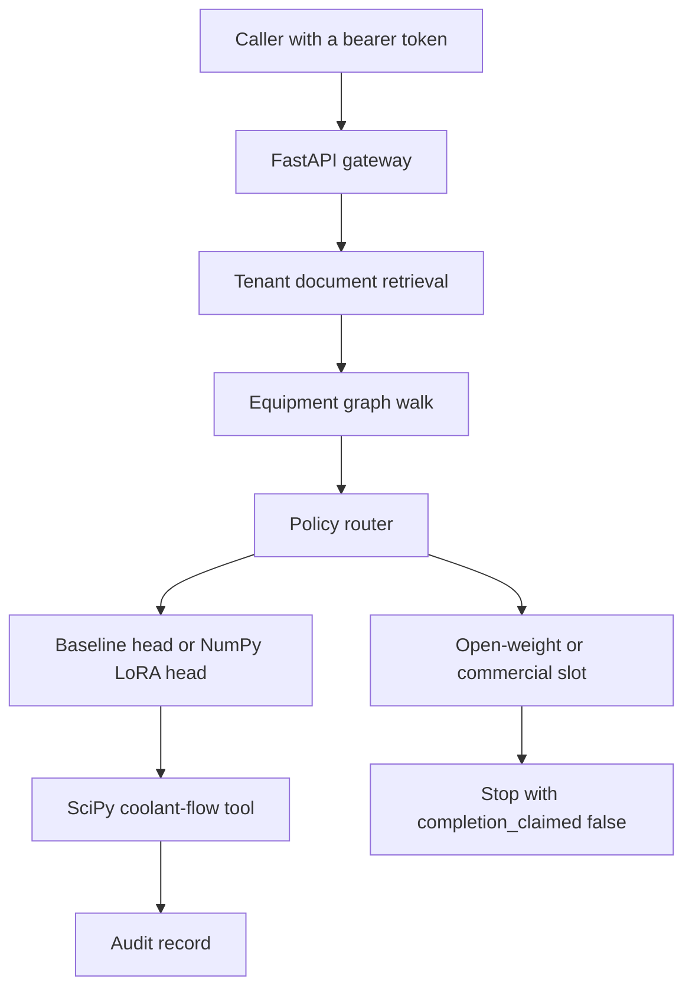

# Architecture

IntelliForge is a reference platform for model routing, local adaptation, evaluation, and governed tool use. The path that runs here is local. Synthetic equipment records stand in for a plant. Qwen 2.5 3B, vLLM, Hugging Face PEFT, bitsandbytes, Neo4j, pgvector, and hosted commercial calls are adapter slots.

**Deployment decision: NO-GO.** No GPU memory figure, no vLLM log, and no hosted completion was collected.

## What runs locally

| Piece | Where it lives | What this repository does with it |
| --- | --- | --- |
| Gateway | `src/gateway/app.py` | `/healthz`, investigations, approvals, audit reads, and `POST /v1/chat/completions` |
| Router | `src/routing/policy.py` | `quality`, `cost`, `open-weight`, `commercial` |
| Local head | `src/serving/local_lora.py` | Rank-2 LoRA trained with NumPy on a synthetic encoder |
| Serving slots | `src/serving/remote.py` | vLLM `Qwen/Qwen2.5-3B-Instruct` and xAI `grok-4.7`. Both fail closed |
| Replacement API | `src/serving/openai_compat.py` | Registered on the main gateway. `numpy-lora-r2-seed7` runs the quality investigation when the prompt contains a `SYN-CASE-` id. The Qwen id returns 503 |
| PEFT entry | `training/peft_lora.py` | Imports PEFT only after the memory preflight allows the Qwen weight load |
| Quantization | `src/serving/quantize.py` | Int8 round-trip of the local matrices |
| Knowledge | `src/knowledge/store.py` | Tenant documents and a three-hop graph loaded from `datasets/synthetic_equipment/` |
| Tool | `src/simulation/setpoint.py` | `scipy.optimize.minimize_scalar` on a typed loss |
| Governance | `src/governance/auth.py` | Fixture tokens, role checks, a different approver for apply |
| Evaluation | `benchmarks/run_quality_eval.py` | Golden cases for the LoRA route and the baseline route |

## Target slots that were not executed

| Slot | Intended tool | Gate |
| --- | --- | --- |
| Open-weight serving | vLLM, `Qwen/Qwen2.5-3B-Instruct` | `vllm-qwen` not-run |
| Adapter training | Hugging Face PEFT | `peft-hf-train` not-run |
| GPU quantization | bitsandbytes | `bitsandbytes` not-run |
| Graph database | Neo4j | `neo4j` not-run |
| Vector database | pgvector | `pgvector` not-run |
| Commercial model | `https://api.x.ai/v1/chat/completions`, model `grok-4.7` | `hosted-commercial-model` not-run |
| Tracking server | MLflow | `mlflow-client` not-run. A local JSON record is written instead |

`docker-compose.yml` defines the API, Postgres with pgvector, Neo4j, and a GPU-profile vLLM service. None of those services were started for the committed benchmark. The open-weight probe is `benchmarks/results/openweight_probe.json`. On this workstation the available physical memory was 2,324,750,336 bytes, and the Qwen2.5-3B BF16 parameter bytes are 6,171,877,376.

## Tenants and the maintenance story

An engineer asks why synthetic process `SYN-PROC-ETCH-01` shows an abnormal chamber temperature. Retrieval returns `SYN-DOC-COOLING` for `tenant-a` only. The graph walk names `SYN-TOOL-01`, `SYN-CHAMBER-A`, `SYN-VALVE-C1`, and `SYN-SENSOR-TEMP`. The quality route classifies with the LoRA head. The SciPy tool recommends a coolant flow fraction. The answer states that the setpoint was not applied.

`apply_setpoint` opens `AWAITING_APPROVAL`. A different approver in the same tenant can accept it. The tool is run again, and the flow must match the stored recommendation before the run is `APPLIED`.

## Companion references

| Repository | Focus |
| --- | --- |
| [H100 GPU factory](https://github.com/JatinF/h100-ai-factory-reference-architecture) | GPU infrastructure acceptance |
| [Healthcare AI factory](https://github.com/JatinF/healthcare-ai-factory-platform) | Synthetic imaging and private inference |
| [IdentityGuard](https://github.com/JatinF/identityguard-agent-platform) | Identity-aware agent control |
| [OrchestraScale](https://github.com/JatinF/orchestrascale-airflow-platform) | Airflow scheduling and Spark-on-Kubernetes sketches |

Each repository keeps its own evidence.
